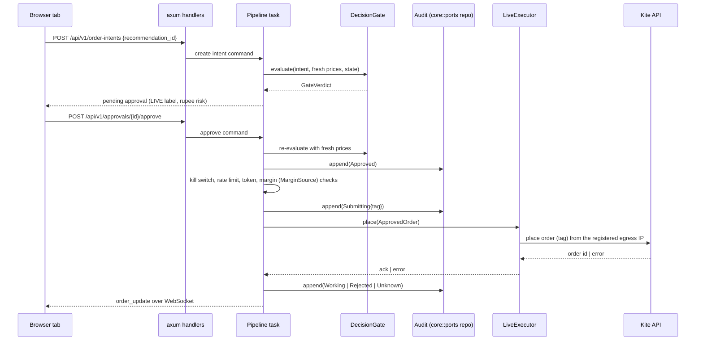

# Live trading phase design (optional depth)

Open this before touching `crates/broker/`, the `ExecutionMode` switch, or anything that sends an order to a real broker. Live trading is the last build phase (phase 9) and starts only after the owner's explicit go-ahead. Bazaar stays local-only and single-user in this phase too: the same `bazaar-server` on `127.0.0.1:8787` on the owner's Mac, built with `live-trading`. This file holds only architectural principles and the send sequence; everything else is owned elsewhere and linked:

- Executor trait, order state machine, approval queue, kill switch, breaker, limiter, audit chain: `bz-execution` (SKILL.md).
- Kite order API mechanics, client tag (`"BZ"` + 18-char base32), placing and reconciliation steps: `bz-execution` `references/live-phase.md`.
- SEBI/NSE retail algo framework, static-IP requirement and the pre-live checklist: only `bz-security` `references/sebi-algo-compliance.md` (state in `config/compliance.toml`).
- Routes, sessions and WebSocket messages the UI uses: `bz-web-api`. Readiness bar and automation safety: `bz-trading-discipline`.

## 1. Principles

1. Same pipeline as paper: `Signal -> Recommendation -> OrderIntent -> DecisionGate -> Approval -> Executor -> Fill`. Live changes only which `Executor` is wired in.
2. Default mode is `paper`; `semi_auto` is the first live mode: the server prepares, the owner approves each order with a click that shows the rupee risk. `auto` is locked and may never be the default.
3. Compiled out by default: crate `broker` behind cargo feature `live-trading`; never in `default`; CI compiles it with the feature but no test calls a live API. The owner builds a live-enabled server locally only when going live (`cargo build -p bazaar-server --features live-trading`, wrapped by a human-run recipe); the default build never contains `broker`.
4. Fail closed: unknown state (token expired, margin unavailable, reconciliation mismatch, clock skew, instrument master stale, wake not yet recovered, broker rejecting the source IP) blocks sending.

## 2. Pre-conditions before the first live order

Record each as a dated entry in `DECISIONS.md` with the source link. The list is the checklist in `bz-security` `references/sebi-algo-compliance.md`; do not keep a second copy. Architecture-specific additions:

- The margin source works for the intended segments (if the margins API is unavailable on the plan, F&O orders are blocked, no hand estimates).
- Paper trading has been stable on the owner's Mac through the readiness period, including sleep/wake recoveries and daily Kite re-logins (`bz-trading-discipline` readiness bar).
- The **static-IP decision** in section 5 is made and recorded.
- The other open items in section 5 are decided.

## 3. Send sequence (semi_auto)

States named here are those of `bz-execution` section 3 (`Approved`, `Submitting`, `Working`, `Rejected`, `Unknown`).

Failure handling:
- Timeout or network error after `Submitting`: state becomes `Unknown`. Reconcile by tag; never retry `place` blindly. The browser request may time out or the tab may close; the pipeline task continues and the result arrives as `order_update` or on the next page load.
- **Mac sleeps or the server stops after `Submitting`**: on restart or wake, `reconcile` (SKILL.md section 8) queries the order book by tag before any new intent is accepted; unresolved orders stay `Unknown` and block new sends for that instrument. Approvals pending across a sleep are expired by `Clock`, never sent late.
- Broker reject: map the reason to a user-readable message; no automatic resubmission with changed parameters. An IP-rejection error engages the kill switch and says so plainly.
- Partial fill: position reflects the filled quantity; remaining quantity follows the intent's validity; stop-loss attaches to the filled quantity.
- Token expiry mid-session: block new sends, keep reading what is possible, prompt re-login; open orders are reconciled after login.
- Double approval from two tabs: first wins, the second gets a conflict; the tag derived from `intent_id` makes a duplicate send impossible.

## 4. Mode transitions

- `paper -> semi_auto`: feature built into the local live build, checklist complete, readiness bar met, server restart, audit event, banner on first page load.
- `semi_auto -> auto`: separate explicit opt-in screen with typed confirmation, checklist re-check; locked again whenever any pre-condition lapses (token expiry, stale `verified_on`, IP check failing).
- Any downgrade is instant and needs no confirmation. A restart or wake never upgrades the mode and never clears the kill switch.
- Daily reset: the daily loss breaker and approval queue are scoped to the IST trading day via `MarketCalendar`.

## 5. Open items to decide with the owner (ADRs)

- **Static IP versus a home connection (owner decision, phase 9).** SEBI's retail algo framework and the broker require order APIs (place, modify, cancel) to come from a registered static IP; reads (market data, order book, positions) are not affected. A home broadband IP is usually dynamic. Before building `broker`, the owner decides how to satisfy this or whether to stay on paper/analysis only: for example an ISP static IP, or another fixed-egress path the owner controls. Current rules, the broker's registration procedure and the weekly-change limit are in `bz-security` `references/sebi-algo-compliance.md`; look them up again at decision time and record the interpretation, source and date in `DECISIONS.md`. Any choice that routes traffic off this Mac (a hosted box, a relay, a tunnel) is an exposure and architecture change: ADR plus security redesign (SKILL.md section 11), and never a third-party relay for orders. Data and paper are unaffected either way.
- How the server verifies its egress IP (a check at startup, after wake and before each session, compared with the registered value in `config/compliance.toml`) without sending account data to third-party services; live modes stay locked until it passes, and a mismatch after a network change (new router, travel, VPN) locks them again.
- Whether stop-loss and target orders are broker-side (GTT or bracket-style, if the broker offers them for the segment) or app-managed. Broker-side survives sleep, crash and shutdown; app-managed does nothing while the Mac sleeps or the server is down, so on a laptop prefer broker-side or explicitly accept the gap.
- Market vs limit order policy (broker rules for market orders vary; look up current).
- Whether the owner keeps the Mac awake during market hours while live orders or open live positions exist (a human habit, not a safety property).
- Backup of `data/` (SQLite with the audit chain) before live orders, recorded in `DECISIONS.md`; secrets only through `SecretStore` (`bz-security`).

## 6. Testing the live phase without live calls

- `wiremock` for Kite REST with recorded JSON from `fixtures/kite/rest/`; a local tokio WS server with `fixtures/kite/ws/` for order updates.
- `FakeClock` for token expiry, approval expiry, MIS square-off windows and a simulated sleep (large clock jump).
- A `RecordingExecutor` for pipeline property tests; the contract test suite also runs `PaperExecutor` so both stay interchangeable.
- Tests assert: no `place` after kill switch or a blocked verdict; idempotent tag reuse; `Unknown` resolves via reconcile, including after a rebuilt core over the same SQLite file and after a simulated wake; with `live-trading` off, `LiveExecutor` is absent from the default build (compile-fail or `cargo tree` check); an egress-IP mismatch locks live modes (fake IP check).
- Connection status for the real session only via `just db-check`; agents never read `.env` or call the broker themselves.
